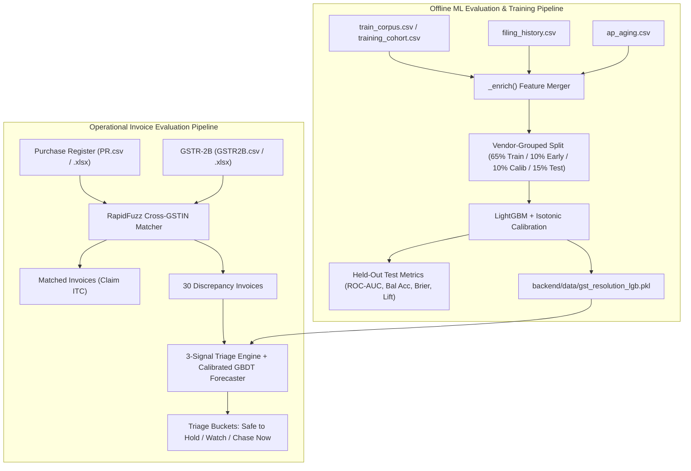

# Model Evaluation & Data Specification Guide

This guide details the exact file requirements, schemas, and pipelines for:
1. **Model Training & Benchmark Evaluation (Offline Backtesting)** via [`backend/train_forecaster.py`](../backend/train_forecaster.py)
2. **Operational Invoice Evaluation & Triage (Inference Pipeline)** via FastAPI [`/api/upload/reconcile`](../backend/main.py) and frontend client-side engines.

---

## 1. High-Level Architecture



---

## 2. File Requirements for Offline ML Model Evaluation

To evaluate model accuracy, calibration, and default-capture lift, run:
```bash
python -m backend.train_forecaster --data <path_to_train_corpus.csv>
```

When scanning for datasets, [`find_best_training_cohort()`](../backend/train_forecaster.py#L548) checks candidate paths in order:
1. `one-20261025T162623Z-1-001/one/train_corpus.csv`
2. `two-20261025T162624Z-1-001/two/train_corpus.csv`
3. `three-20261025T162623Z-1-001/three/train_corpus.csv`
4. `backend/data/training_cohort.csv`

### Required File Schemas

#### A. `train_corpus.csv` (Primary Target & Feature Matrix)
Contains historical invoice transactions with resolved ground truth.

| Column | Type | Example | Description |
|:---|:---|:---|:---|
| `org_id` | String | `ORG0` | Buyer enterprise entity ID (used in vendor grouping). |
| `vendor_gstin` | String | `27ABCDE0029Z1P29` | 15-character Supplier GSTIN. |
| `invoice_no` | String | `INV/9Z1P29/000000` | Invoice reference identifier. |
| `irn_present` | String | `active` / `absent` / `unknown` | Status on Invoice Registration Portal (IRP). |
| `leverage_score` | Float | `0.955` | Combined commercial unpaid and retention ratio. |
| `retention_active` | Boolean | `True` / `False` | Whether contract retention balance is held. |
| `paid_in_advance_ratio` | Float | `0.0` | Proportion of invoice settled prior to delivery. |
| `outstanding_payable_ratio`| Float | `0.705` | Ratio of total outstanding AP to invoice value. |
| `filing_pattern` | String | `punctual` / `habitual_laggard` / `sudden_silence` | Supplier filing periodicity code. |
| `current_delay_z` | Float | `2.1` | Normalized delay standard deviations from supplier mean. |
| `is_credit_note` | Boolean | `False` | Transaction document type flag. |
| `is_format_divergence` | Boolean | `False` | Whether mismatch was pure typo/rounding vs missing return. |
| `buyer_posted_flag` | Boolean | `False` | True if ledger was posted without counterparty GSTR-1 credit. |
| `value_mismatch_pct` | Float | `0.0` | Discrepancy percentage between PR and portal return. |
| `days_to_16_4` | Integer | `34` | Days remaining until statutory Section 16(4) credit reversal deadline. |
| `rupees_at_risk` | Float | `51062.25` | Total Input Tax Credit exposure (INR). |
| `compliance_history_band` | String | `perfect` / `good` / `mixed` / `poor` | Historical categorical grading. |
| `self_correct` *(Target)* | Integer | `1` / `0` | Ground truth: `1` if resolved before deadline, `0` if defaulted. |

> [!NOTE]
> In simplified standalone cohorts like `backend/data/training_cohort.csv`, the target column is named `resolved_target`. The loader accepts either column transparently.

#### B. `filing_history.csv` (Supplier Periodicity Enrichment)
*Must reside in the same directory as `train_corpus.csv`.*

| Column | Type | Example | Description |
|:---|:---|:---|:---|
| `org_id` | String | `ORG0` | Buyer entity identifier. |
| `vendor_gstin` | String | `27ABCDE0000Z1P00` | Supplier GSTIN. |
| `cycle` | String | `2024-01` | Return filing cycle month. |
| `filed_date` | String | `2024-01-05` | Timestamp return was accepted on GST portal. |
| `statutory_due_date` | String | `2024-01-05` | Statutory due date under CGST rules. |
| `delay_days` | Integer | `31` | Net filing delay past statutory deadline. |
| `missed_cycle_flag` | Boolean | `False` | `True` if period was permanently skipped. |

The script aggregates this file to engineer:
- `v_mean_delay` & `v_median_delay`: Central tendency of supplier delays.
- `v_max_delay` & `v_std_delay`: Volatility and extreme tail risk.
- `v_missed_ratio`: Ratio of completely skipped filing cycles.

#### C. `ap_aging.csv` (Accounts Payable Commercial Leverage Enrichment)
*Must reside in the same directory as `train_corpus.csv`.*

| Column | Type | Example | Description |
|:---|:---|:---|:---|
| `org_id` | String | `ORG0` | Buyer entity identifier. |
| `vendor_gstin` | String | `27ABCDE0000Z1P00` | Supplier GSTIN. |
| `period` | String | `2024-06` | AP snapshot month. |
| `outstanding_payable` | Float | `374951.22` | Total gross accounts payable balance on hold. |
| `retention_held` | Float | `15416.30` | Contractual milestone retention held back. |
| `days_since_last_payment` | Integer | `52` | Days elapsed since last disbursement. |
| `paid_in_advance_ratio` | Float | `1.0` | Proportion advance disbursed. |

---

## 3. File Requirements for Operational Invoice Evaluation (Inference)

When running the operational reconciliation and triage API ([`POST /api/upload/reconcile`](../backend/main.py#L383)) or client-side upload:

### A. Purchase Register (`PR.csv` or `PR.xlsx`)
Internal Accounts Payable invoice register.

- **Mandatory Columns:**
  - `invoice_number` (Aliases: `invoice_no`, `invoiceno`, `inv_no`, `bill_no`)
  - `supplier_gstin` (Aliases: `vendor_gstin`, `gstin`, `party_gstin`)
  - `total_tax` (Aliases: `tax_amount`, `totaltax`, `taxamount`, `gst_amount`)
  - `taxable_value` (Aliases: `taxable_amount`, `taxable`)
  - `gross_amount` (Aliases: `total_amount`, `invoice_value`, `total`)
  - `invoice_date` (Format: `YYYY-MM-DD` or standard date string)
- **Optional Columns:**
  - `supplier_name` (Defaults to GSTIN prefix if omitted)

### B. GSTR-2B (`GSTR2B.csv` or `GSTR2B.xlsx`)
Auto-drafted counterparty return file downloaded from the GST Portal.

- **Mandatory Columns:**
  - `invoice_number`
  - `supplier_gstin`
  - `total_tax`
  - `taxable_value`
  - `invoice_date`

### C. Pre-Trained Model Artifact
- **Backend:** `backend/data/gst_resolution_lgb.pkl`  
  Contains the serialized LightGBM tree ensemble, Isotonic Regression calibrator, optimal decision threshold, and gain-based feature weights.
- **Frontend Client:** `vite-app/src/lightgbmTrees.ts`  
  Compiled static JSON tree representation enabling immediate browser-side inference without server roundtrips.

---

## 4. Summary Quick Reference

| Task | Primary File | Support / Enrichment Files | Output / Evaluation Result |
|:---|:---|:---|:---|
| **Model Evaluation & Training** | `train_corpus.csv` | `filing_history.csv`<br>`ap_aging.csv` | Validation ROC-AUC, Balanced Accuracy, Brier score, and saved `gst_resolution_lgb.pkl` |
| **Invoice Reconciliation & Triage** | Purchase Register (`PR.csv`) | `GSTR-2B.csv`<br>`gst_resolution_lgb.pkl` | Matched vs Unmatched counts, Risk Buckets (Safe / Watch / Chase), Expected Loss |
